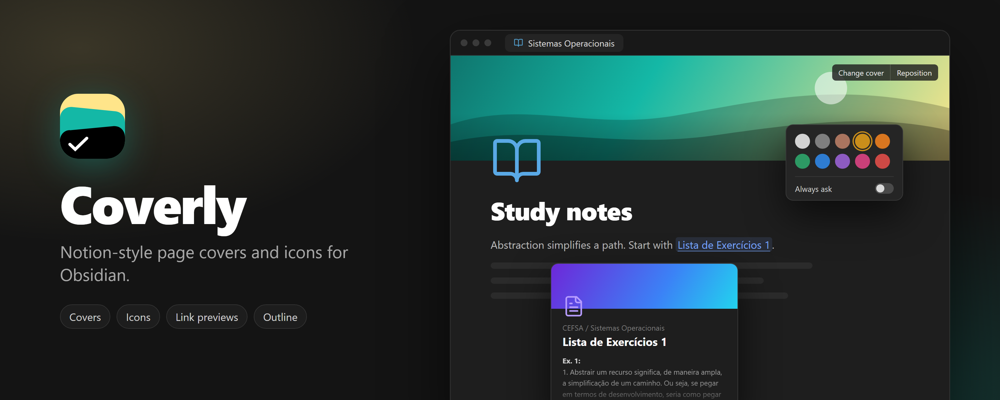

<div align="center">



<p>
  <a href="https://github.com/Edgarcsr/obsidian-coverly/releases"><picture><source media="(prefers-color-scheme: dark)" srcset="https://shieldcn.dev/github/downloads/Edgarcsr/obsidian-coverly.svg?variant=outline&mode=dark"></picture></a>
  <a href="https://obsidian.md"><picture><source media="(prefers-color-scheme: dark)" srcset="https://shieldcn.dev/badge/Obsidian-1.8.7%2B-7c3aed.svg?logo=obsidian&variant=outline&mode=dark"></picture></a>
  <a href="LICENSE"><picture><source media="(prefers-color-scheme: dark)" srcset="https://shieldcn.dev/github/license/Edgarcsr/obsidian-coverly.svg?variant=outline&mode=dark"></picture></a>
</p>

</div>

## Features

- **Page covers**: pick a color or gradient, a public domain artwork, an
  Unsplash photo, an uploaded image, a link, or paste an image with
  **Ctrl+V**. Drag to reposition. Height, rounded corners, bottom fade and
  bottom shade are configurable.
- **Page icons**: any Unicode emoji (optionally drawn with Twemoji), any
  Lucide icon in a color of your choice, or a custom image.
- **Icons everywhere**: the note icon also shows in the tab title and the
  file explorer.
- **Heading outline**: a slim outline on the right edge of the note that
  expands on hover and jumps to a heading on click.
- **English and Portuguese** interface, following Obsidian's language by
  default.

Covers and icons are stored in the note's frontmatter (`cover`,
`cover-position`, `cover-credit`, `cover-credit-url`, `icon`), so your notes
stay plain Markdown.

## Network use

Coverly works offline. It only reaches the network for these features:

- **Unsplash** (`api.unsplash.com`): searching photos, only after you add
  your own Unsplash access key in the settings.
- **Twemoji** (`cdn.jsdelivr.net`): downloading emoji images the first time
  they appear. They are cached in the plugin folder. Turn off **X-style
  emojis** in the settings to use system emojis instead.
- **Gallery artworks** (`images.metmuseum.org`, `commons.wikimedia.org`):
  loading the public domain images shown in the cover gallery.

No note content, file names or personal data are sent anywhere.

## Installation

Until Coverly is listed in the community catalog, install it manually:

1. Download `main.js`, `manifest.json` and `styles.css` from the latest
   release.
2. Copy them to `<Vault>/.obsidian/plugins/coverly/`.
3. Reload Obsidian and enable **Coverly** in **Settings → Community
   plugins**.

## Development

```bash
bun install
bun run dev
```

`bun run build` makes a production build and `bun run check` runs the
linter and formatter checks.

## License

[MIT](LICENSE)
