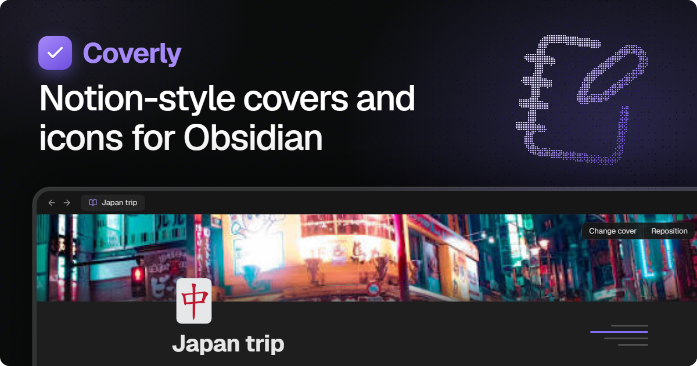

<div align="center">



<p>&nbsp;</p>

<p>
  <a href="https://github.com/Edgarcsr/obsidian-coverly/releases"><picture><source media="(prefers-color-scheme: dark)" srcset="https://shieldcn.dev/github/downloads/Edgarcsr/obsidian-coverly.svg?variant=outline&mode=dark"></picture></a>
  <a href="https://obsidian.md"><picture><source media="(prefers-color-scheme: dark)" srcset="https://shieldcn.dev/badge/Obsidian-1.13.0%2B-FFE58A.svg?logo=obsidian&variant=outline&mode=dark"></picture></a>
  <a href="LICENSE"><picture><source media="(prefers-color-scheme: dark)" srcset="https://shieldcn.dev/github/license/Edgarcsr/obsidian-coverly.svg?variant=outline&mode=dark"></picture></a>
</p>

<p>
  <a href="https://youtu.be/qEFwSZ2j1Ho"><b>Watch the video overview on YouTube</b></a>
</p>

</div>

## Features

- **Page covers**: pick a color or gradient, a public domain artwork, an Unsplash photo, an uploaded image, a link, or paste an image with **Ctrl+V**. Drag to reposition. Height, rounded corners, bottom fade and bottom shade are configurable.
- **Note background** (beta, off by default, **Settings → Coverly**): give a single note a color, gradient, vault image or linked image as its background, softened so the text stays readable. Use **Change note background** from the command palette or the button above the title.
- **Accent color per note** (off by default, **Settings → Coverly**): change the theme's accent color (links, buttons, checkboxes) for a single note.
- **Vault images**: pick covers, icons and backgrounds from images already in your vault.
- **Note font**: switch a single note between the theme font, a serif and a monospace font, from the command palette or the button above the title. With **Custom fonts per note** on (off by default), you can also type the name of any font installed on your computer.
- **Colored names** (off by default, **Settings → Coverly**): pick a color for a note and its name is painted with it in the file explorer.
- **Page icons**: any Unicode emoji (optionally drawn with Twemoji), any Lucide icon in a color of your choice, or a custom image.
- **Icons everywhere**: the note icon also shows in the tab title and the file explorer.
- **Heading outline**: a slim outline on the right edge of the note that expands on hover and jumps to a heading on click.
- **English and Portuguese** interface, following Obsidian's language by default.

Covers and icons are stored in the note's frontmatter (`coverly-cover`, `coverly-position`, `coverly-credit`, `coverly-credit-url`, `coverly-icon`, `coverly-background`, `coverly-font`, `coverly-accent`, `coverly-color`; notes using the older `cover`/`icon` names are still read and are migrated the next time you change them), so your notes stay plain Markdown.

## Network use

Coverly works offline. It only reaches the network for these features:

- **Unsplash** (`api.unsplash.com`, `images.unsplash.com`): searching photos and loading the ones you pick, only after you add your own Unsplash access key in the settings. Picking a photo also sends Unsplash a download notice, as their API guidelines require.
- **Twemoji** (`cdn.jsdelivr.net`): downloading emoji images the first time they appear. They are cached in the plugin folder. Turn off **X-style emojis** in the settings to use system emojis instead.
- **Gallery artworks** (`images.metmuseum.org`, `commons.wikimedia.org`, which redirects to `upload.wikimedia.org`): loading the public domain images shown in the cover gallery.
- **Images from links**: if a cover or icon comes from a web address, Obsidian loads that image from its host each time the note is shown, unless **Download covers** is on.
- **Download covers** (off by default, **Settings → Coverly**): saves a copy of each cover that comes from the web (Unsplash, gallery artworks, links) in a vault folder (`.cover` by default), so it opens from disk instead of the network. Covers are downloaded from their original host the first time they are shown, or all at once with **Download all covers used in the vault** from the command palette. The note still stores the original address, so it keeps working in other vaults. Obsidian Sync skips folders whose name starts with a dot, so each device keeps its own copies unless you choose a different folder.

No note content, file names or personal data are sent anywhere.

## Installation

Until Coverly is listed in the community catalog, install it manually:

1. Download `main.js`, `manifest.json` and `styles.css` from the latest release.
2. Copy them to `<Vault>/.obsidian/plugins/coverly/`.
3. Reload Obsidian and enable **Coverly** in **Settings → Community plugins**.

## Development

```bash
bun install
bun run dev
```

`bun run build` makes a production build and `bun run check` runs the linter and formatter checks.

### Releasing

Releases are automated. Bump the version in `manifest.json`, `package.json`
and `versions.json` (`bun run version` does it from `package.json`), then push
to `main`. If that version has no release yet, the **Release Obsidian plugin**
workflow builds the plugin, creates the tag (no `v` prefix) and publishes the
release with `main.js`, `manifest.json` and `styles.css`.

## License

[MIT](LICENSE)
